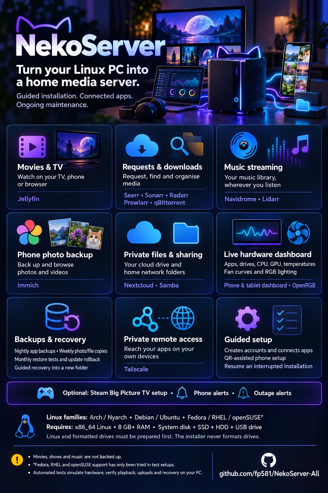
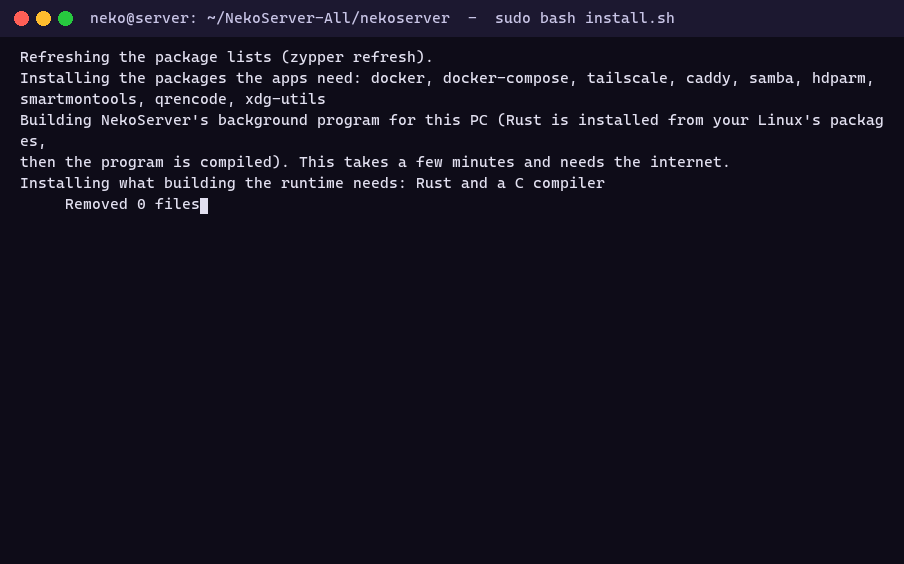
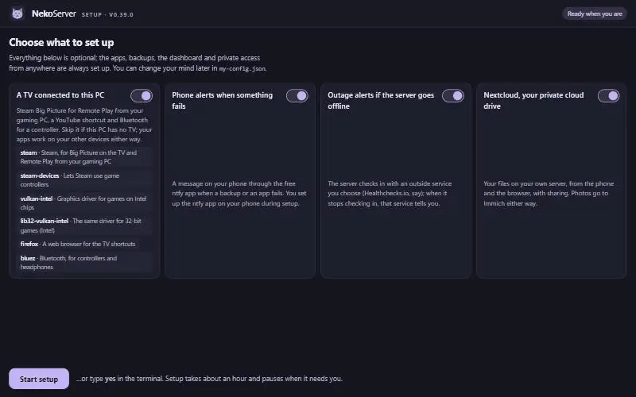
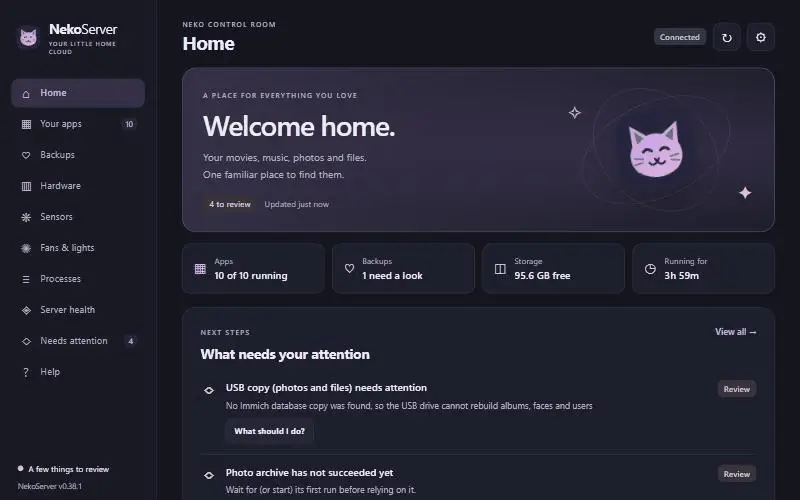
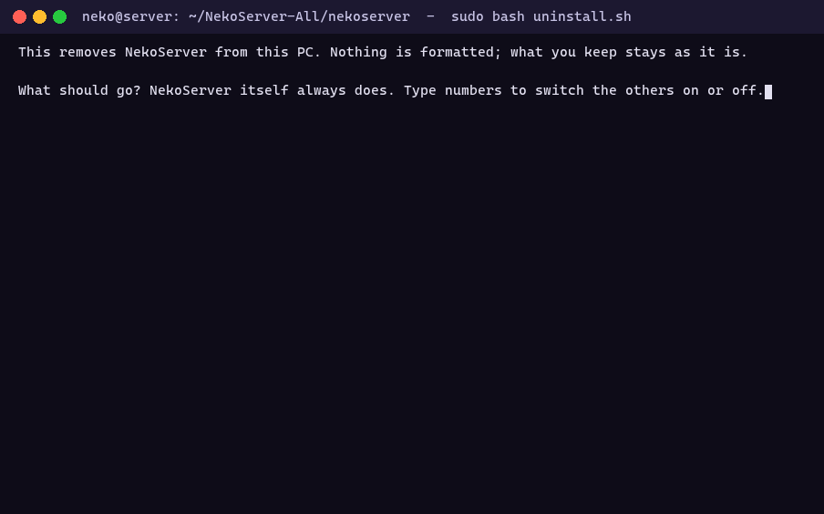

# NekoServer

<p align="center">
  
</p>

**Turn a Linux PC into a home media server**, with your own video library, phone photo backup, music streaming and private cloud drive, set up by one guided installer that creates every account, connects the apps to each other and walks you through anything that needs you, one yes/no step at a time. It never formats a drive.

| | |
| --- | --- |
| 🎬 **Movies & TV** | Jellyfin, with Seerr for requests and Sonarr / Radarr / Prowlarr / qBittorrent to find and download |
| 📷 **Photos** | Immich: automatic backup from your phone |
| 🎵 **Music** | Navidrome (with Lidarr) |
| ☁️ **Files** | Nextcloud: your own cloud drive, and Samba folders on the home network |
| 🛡️ **Backups** | Nightly app backups, weekly photo and file copies to an HDD and a USB drive, monthly restore tests, rollback after a failed update |
| 🏠 **Access** | Secure at home, and optionally from anywhere with Tailscale |
| 🖥️ **Dashboard** | Apps, drives, temperatures, fan curves and RGB lighting, from any phone or browser at home |

## See it

Every recording below is a real run on the test rig (openSUSE Tumbleweed under WSL), as it happened. Nothing is staged.

**The installation.** One command. Setup checks the PC, asks for the drives, creates the accounts, deploys the apps and tells you what it did and what still needs you.

<p align="center"></p>

**The setup window.** The same questions, answered in a small window instead of the terminal if you prefer, with what each step installs and why, in plain words.

<p align="center"></p>

**The dashboard.** Your apps, drives, backups, hardware and what needs your attention, on the PC and on your phone.

<p align="center"></p>

**The uninstaller.** NekoServer off the PC, what you choose, after two confirmations. Nothing is formatted.

<p align="center"></p>

## Get started

NekoServer runs on **Arch Linux, Nyarch, Debian 12+, Ubuntu 24.04+, Fedora 42+, RHEL 10+ and openSUSE Leap 16+ / Tumbleweed** (with Rocky Linux, AlmaLinux and CentOS Stream 10+; and systems built on Arch, Debian or Ubuntu, such as Linux Mint), with more to come. Fedora, RHEL and openSUSE support are new and were tried only in a test setup without SELinux: testers on those are very welcome. It hasn't been proven on a real install yet, so try it on a spare PC or a virtual machine first.

You need a 64-bit PC with one of those installed, plus an SSD, an HDD and a USB drive, already formatted.

```bash
git clone https://github.com/fp581/NekoServer-All.git
cd NekoServer-All/nekoserver
sudo bash install.sh
```

Then follow the step-by-step guide: **[nekoserver/README.md](nekoserver/README.md)**.

You can follow the installation in the terminal, and on a PC with a desktop also in a setup window in your browser: [how to open each](nekoserver/README.md#two-ways-to-follow-the-installation-the-terminal-and-the-setup-window).

Already running NekoServer? Run `git pull`, then `sudo bash install.sh` in the same folder: your settings stay where they are ([Updating to a newer release](nekoserver/README.md#install)).

Cloned before 0.40.0 (running 0.39.x or older)? Then `git pull` does not work once: the repository's history was cleaned in 0.40.0. Clone it again and copy your `my-config.json` into the new `nekoserver` folder, as [Updating from a clone made before 0.40.0](nekoserver/README.md#install) shows step by step.

Want it gone? `sudo bash uninstall.sh` in the same folder: it lists what it would remove, you choose, and it asks twice ([Uninstalling](nekoserver/README.md#uninstalling)).

## More

- What changed in each version: [CHANGELOG.md](CHANGELOG.md)
- How support for another Linux family is added: [PORTING.md](nekoserver/PORTING.md)
- Every change is tested automatically in GitHub Actions. The tests simulate the hardware, so try a full round on your own PC (play a video, upload a photo, restore a file) before trusting it with your only copy of anything.
