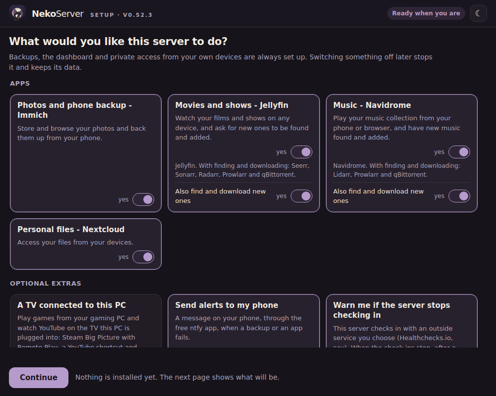

# Guided setup: what it asks, and what to answer

`sudo bash install.sh` sets up your whole server in one go. It stops whenever it needs you, explains what to do, and waits for your answer. This page walks through every question in the order you will see it, and says what to answer.

The technical details (how the setup window works inside, every guided step, running without a screen) are at the end, under [For administrators](#for-administrators).

## Before you start

Have these ready:

- **Your drives plugged in and formatted** (ext4 is the safe choice): a fast one for the apps (this guide calls it the SSD), a big one for your films and the backups (the HDD) and, if you have one, a USB drive for the offline backup. One drive, or the disk Linux runs from, can also hold everything. Setup never formats a drive. It needs at least **20 GB free on the SSD** and **50 GB free on the HDD** to start; **100 GB** and **500 GB** or more are recommended.
- **Your phone**, with its app store working.
- **Only if you want to choose your own logins:** a PIN you will remember (6 to 8 digits) for the dashboard. With the recommended choice, setup makes every password and the PIN for you.
- **About an hour**, and the PC connected to the internet.

Open a **terminal**: press **Ctrl+Alt+T**, or open the apps menu and search for **Terminal**. Then type (or copy and paste) these two lines, pressing Enter after each:

```bash
cd NekoServer-All/nekoserver
sudo bash install.sh
```

`sudo` asks for **your own login password**. Nothing appears while you type it; that is normal. Press Enter when done.

Answers are typed in the terminal and finished with Enter: `yes` or `no`, a number from a list, or a password. You can stop at any time with **Ctrl+C**. Running `sudo bash install.sh` again later continues where it stopped; nothing already done is lost.

## What setup asks, screen by screen

### 1. Getting the PC ready (no questions, 5 to 15 minutes)

Setup first installs the programs the apps need, and then builds NekoServer's own background program. The terminal shows a lot of text; you don't need to read it. On Arch, the whole system is updated first. There is no setup window yet during this part.

If it stops with an error here, it says what went wrong. Most often it is the internet connection, or a website that your network blocks. Fix that, then run `sudo bash install.sh` again.

### 2. Welcome, and the setup window

When the PC is ready, the terminal shows a short welcome text and setup's first page, **What would you like this server to do?** On a PC with a desktop, a small **setup window** opens in your web browser at the same time. It shows the same questions as the terminal, with buttons. You can answer in either place.



The window opens in the **Night** look, like the dashboard. The ☾ / ☀ button at its top right switches to **Lamplight** (light) and back; the browser remembers your choice.

The first page lists what this server can do, each with a switch that says yes or no (in the terminal: a numbered line; type its number to switch it):

- **Apps**: Photos and phone backup (Immich), Movies and shows (Jellyfin), Music (Navidrome), Personal files (Nextcloud). Inside Movies and shows and inside Music is one more switch, **Also find and download new ones**, on unless you switch it off: off leaves Jellyfin, or Navidrome, alone; see [the media groups](#the-media-apps-three-groups-a-yes-or-no-each) below.
- **Optional extras**, off until you switch them on: a TV connected to this PC (Steam Big Picture; it needs **Movies and shows**, because its TV mode opens Jellyfin, and its card is greyed while that is off), alerts on your phone when something fails, a warning from outside when the server stops checking in, and a local AI assistant for the dashboard ("Ask Neko"; see ASSISTANT.md). With the drives: media and backup drives in a NAS (a storage box on your home network), and **Backup cards** (SD cards or USB sticks you keep somewhere else). These switches are your answer: no step asks "do you want this?" again.

Each card has a line **Installs N packages** where it adds some: press it to see what that part adds to the PC. Choosing something never moves the rest of the page. **Continue** (in the terminal: Enter) goes on to the drives ([Choosing the drives](#choosing-the-drives), below), the backup times, the app passwords ([step 6](#6-app-passwords)), and then to the review, **Ready to install NekoServer**: the apps that will be installed, the extras, what is left out, what is always set up, where your apps and files are kept, and what setup still stops to ask you. One button starts it, **Install selected apps** (in the terminal: type `yes`; `back` returns to the first page; Enter alone approves nothing). Nothing is installed or mounted before it. Each switch is written to `my-config.json` as you press it, and at the approval every switch is saved with its answer, so no step asks "install this?" again.

On a PC that already has NekoServer, setup says so before this page: which release is set up and where, or that a setup was cut off and at which step, with the choices that apply (continue, review this update, change apps or settings, restore from a backup).

### 3. Your drives

The drives are chosen right after the first page, before anything is installed. First, a word on the three media groups of the first page, because they decide which places setup asks for.

#### The media apps: three groups, a yes or no each

The three media groups are on setup's first page, and each can be left out:

- **Photos and phone backup**: **Immich**, your own photo backup and gallery, with its archive and its weekly offline copy.
- **Movies and shows**: **Jellyfin** to watch your films and shows, with video on the graphics chip. With **Also find and download new ones** on (it is, unless you switch it off): **Seerr** to ask for new ones, and **Sonarr, Radarr and Prowlarr** with **qBittorrent**, which find and download them.
- **Music**: **Navidrome**, your music player, with the music backup. With **Also find and download new ones** on: **Lidarr**, with Prowlarr and qBittorrent, finds and downloads music; it does not need Movies and shows.

All three together take about 6 GB on the SSD and about 2 GB of memory when idle. Any combination works: all of them, photos alone, music alone, or none for a smaller server. The dashboard, the backups, Tailscale and the shared folders are set up either way. A group you leave out is not asked about again: no place for its files, no sign-in, no test.

You can change your mind. Run `sudo bash install.sh` again and switch the line on the first page the other way. **Yes later** installs its apps as on any server. **No later never deletes anything**: the apps of that group are stopped, and their settings, your photos, music and films and every backup stay where they are, so yes brings them back as they were.

#### Choosing the drives

The drives are chosen after the first page and before the one approval; they are mounted (connected to their folders) once setup has started. Before the first drive question, setup shows **everything connected to this PC**, numbered. Each drive says what it is (its model, its size, whether it is an SSD, an HDD, an NVMe drive, a USB drive or a disk on a NAS (a storage box on your home network), and the name you gave it), what it can be used as or why it cannot be used, and its details (Linux's name for it, how it is formatted, where it is open, how full it is):

```text
Everything connected to this PC:
  1) WD SN770, 477 GB NVMe SSD - the disk Linux runs from
       Can be the app SSD or the media HDD.
       Details: nvme0n1
  2) Samsung SSD 870, 466 GB SSD, named "apps" - ready to use
       Can be the app SSD, the media HDD or the USB backup drive.
       Details: sda1 on sda; ext4, UUID ssd-0001; not open; about 1 % full
  3) WDC WD20EZRZ, 1.8 TB HDD, named "media" - has files: kept as they are
       Can be the app SSD, the media HDD or the USB backup drive.
       Details: sdb1 on sdb; ext4, UUID hdd-0001; open at /run/media/neko/media; about 40 % full, holds files
  6) ST1000DM010, 932 GB HDD - can't be used: it has no filesystem yet
```

The names in the details (`sda1`, `sdb1`) are Linux's own and can change at the next start. NekoServer remembers a drive by its ID (the UUID in the details), which you never have to type. Setup never formats a drive; for a new drive the list gives the command to run yourself.

1. Each question names the role and what goes on that drive, for example `Number of the drive for your apps, photos and music (the app SSD)`. Type the drive's **number** from the list and press Enter. A drive that cannot have that role is in the list with the reason ("not this one: it is too small ..."); choosing it anyway says why and asks again.
2. Each line comes with a recommended drive, marked in the list: press Enter to take it. Nothing is typed back: choosing a drive formats nothing and changes nothing on it, and setup says the choice back in words (`Drive 2 (Samsung SSD 870, 466 GB SSD, named "apps") is the app SSD. Nothing on it is changed by choosing it.`).
3. The same follows for the media HDD, which is the drive every backup goes to (the window's line **Backups**). The disk Linux runs from can be chosen for either (a PC with one drive): setup then keeps that part in a folder of it and says what that means (if that disk fails, both go together; a full disk stops Linux too).
4. Then where Immich's photos, the films and shows, the music and Nextcloud's files are kept: the drive of the apps, the backups' drive, or another connected drive of their own, so the backups can be alone on a drive. Enter takes the recommended place. Photos (and music, where its backup is switched on) kept on the backups' drive are told that their backup copy is then on the same drive: it protects against a mistake, not against losing that drive.
5. The apps themselves (their settings and databases) are installed together, on the drive of NekoServer and your apps. A drive of their own for one group's apps is not offered yet.
6. Then the removable drive for the offline backup. It is optional: Enter (in the window, **None for now**) leaves it out, saved as your choice, and nothing asks about it again.
7. Then whether you already have films, shows or music: the folder of each (and any other folder of the same kind, up to 8, until you answer **That is all**), whether it is used where it is or copied into the library, and whether new ones are saved there too.
8. **In the setup window** all of this is one page, **Where should NekoServer store your apps and files?**, with a list to choose from on every line and the recommended drive already chosen. A drive that cannot have a role is in the list with the reason and cannot be chosen. Press **Use these drives**.

Then come two more pages before the review: **the backup times** (Enter keeps the times shown) and **the app passwords** ([step 6](#6-app-passwords)). Then the review, and your `yes` (step 2). Everything from step 4 on happens once setup has started.

### 4. Tailscale: reaching your server from anywhere

Tailscale is a free app that lets your own phone and laptop reach the server privately, at home or away. Setup opens the Tailscale sign-in page in your browser.

1. Create a free account, or sign in (with Google, Microsoft, Apple or GitHub). Use the account you will also use on your phone.
2. Press **Connect** when the page asks, to add this PC to your account.
3. Go back to the terminal and answer `yes` to `Is this server connected to Tailscale?`. Setup checks it itself, too.

Answer `no` to see the step again and reopen the page. If no page opened, the step says what to do instead: run `sudo tailscale up` in a second terminal and open the link it prints.

### 5. Drive space

Setup checks that the drives have room. If a drive has less than the recommended space, it says so and asks `One of your drives is small. Go on anyway?`. Answer `yes` to go on; the drive will just fill up sooner.

If a drive is too small (less than 20 GB free on the SSD, or 50 GB on the HDD), setup stops. Free up space on that drive and run `sudo bash install.sh` again. To use a different drive instead: open `my-config.json` (in the same folder as `install.sh`), find the `"storage"` part, and delete the line `"uuid": "…",` under `"data_ssd"` (the SSD) or `"media_hdd"` (the HDD). Save the file and run `sudo bash install.sh` again: it asks for that drive anew.

### 6. App passwords

This page comes before the review, right after the drives and the backup times. Every app gets its own administrator login, and the server gets a dashboard PIN and a password for the shared folders. Setup asks:

```text
How would you like to set up your app accounts?
Each selected app has a separate account. NekoServer stores its required credentials privately so it can connect and check the apps.
  1) Create strong passwords for me (recommended)
  2) Choose my own logins
Type 1 or 2, then press Enter. Enter alone takes the first.
```

Type `1` and press Enter (recommended). Setup then makes a long random password for each app, an 8-digit dashboard PIN and the shared-folder password, and saves them on the server. Nothing more is asked. You never have to remember them: [Seeing an app's password](#seeing-an-apps-password) shows how to look one up.

Choose `2` only if you want to type your own. Then you type a username and password for every new app (12 characters or more), the dashboard PIN (6 to 8 digits; Enter alone for no PIN) and the shared-folder password, each one twice; nothing appears while you type. These are saved on the server too, and "Show login" shows them.

### 7. Installing the apps (no questions, 15 to 60 minutes)

Setup now downloads and starts the apps: Jellyfin, Immich, Nextcloud, Navidrome and the others. This is the longest wait. You can watch the progress in the setup window.

### 8. Connecting the apps, music and the shared-folder password

These three steps ask a few questions of their own. Since 0.50.0 they are asked in the setup window too, like every other question: answer in the window or in the terminal, whichever you like.

- **Connecting the media apps.** Setup may ask which download sources (Prowlarr calls them indexers) to add. If you don't know what to choose, just press Enter: that adds the recommended ones, which are already ticked (with nothing ticked, Enter skips it). You can add or remove sources later in Prowlarr.
  - **Several at once.** In the setup window the whole of Prowlarr's catalogue is one list that scrolls, with a search box and a tick box on every row; each row says whether the source is public or needs an account, its language, and whether it is for torrents or Usenet. Tick as many as you like (the page counts them) and press **Add the selected ones**. In the terminal, filter the list by name if you like, then type the numbers together: `1 4 7`, or a range such as `1-5`.
  - **The ones that need no account are added at once.** Each one that needs a login or a key then gets a small form of its own (the login is typed hidden). **Skip for now** leaves that one out; the others are not affected.
  - **One that Prowlarr refuses** is shown with Prowlarr's reason and **Retry this step**, which asks for its values again (a mistyped key is the usual cause). The others are added all the same.
  - **Recommended.** NekoServer ships a short list of recommended sources. They are a group of their own and are ticked from the start: one button ticks them again in the window, and `r` chooses them in the terminal. The list is a small file (`recommended-indexers.json`) of names from Prowlarr's own catalogue; a name Prowlarr no longer has is left out.
  - Use only providers and content you are authorized to access.

When you run `sudo bash install.sh` again later, setup shows how you answered the optional questions last time (the media apps, the backup times, the download sources, the indexers, the playback test) and asks `Change any of these answers?`. Answer `no` to keep those answers and move on; `yes` asks them again.
- **Music** (only if the automatic check did not pass). If setup asks for `Listener username:` and a password, type the login of Navidrome's listener, the account the music check signs in with (not your own login on a server set up with 0.50.0 or later). To see it, open a second terminal (Ctrl+Alt+T) and run the command in [Seeing an app's password](#seeing-an-apps-password) with `show navidrome_listener`.
- **The shared-folder password** (only if it was not chosen on the accounts page, in step 6, for example after three mismatches there). This is the password other computers at home use to open the shared folders. In the terminal, type it, press Enter, then type it again; nothing appears while you type. In the window it is one page with two hidden fields, which must match before it can be sent. A password typed here is handed straight to Samba and not kept. One from the accounts page is kept with the app logins, so "Show login" shows it.

Setup may also ask you to **play something** in Jellyfin as a test. That is optional: answer `yes` once a video played, or press Ctrl+C to skip it (at this one question Ctrl+C skips the test and setup goes on; in the window: **Skip for now**).

### 9. The dashboard PIN

The dashboard is a page that shows how your server is doing. Its **PIN** (6 to 8 digits) lets you change fans and lights from your phone, and restart an app from the dashboard. It is made or chosen on the accounts page (step 6), and this step only sets it. Only when none was chosen there (left empty, or typed wrong three times) does this step ask for one, typed twice (nothing appears while you type). Press Enter instead to skip it; you can choose one later by running setup again.

### 10. The TV (optional)

Only if you switched on **A TV connected to this PC** on the first page: setup then sets up Steam Big Picture and walks you through a few tests on the TV. With the switch off, nothing is asked.

### 11. Your phone

**First, two switches in Tailscale** (once). Setup opens a Tailscale settings page in the browser and asks `Did you switch on both settings in Tailscale?`. On that page, switch on **MagicDNS** and **HTTPS Certificates** (the step says where each one is), then answer `yes`. They give each app a safe address of its own; nothing is opened to the internet.

Then setup opens a **phone setup page** on the PC with a QR code for each app. Keep it open. For each app, the terminal tells you which phone app to install and what to type.

1. **Tailscale first.** Install **Tailscale** on the phone (or scan the first QR code), sign in with the **same account** as in step 4, allow the VPN (the phone asks whether Tailscale may set up a private connection; it must), and switch it on.
2. **Then each app**, one at a time: Jellyfin (movies and shows), Seerr (requests), Immich (photos), Navidrome (music), Nextcloud (files) and the dashboard. Scan the app's QR code with the phone camera to open its address, or type the address shown.
3. **Signing in.** The terminal shows the app's username. To see its password, open a **second terminal** on the PC (Ctrl+Alt+T) and run the command the step shows, for example:

   ```bash
   sudo python3 /srv/nekoserver/installer/releases/v0.52.3/account-setup.py show jellyfin
   ```

   It shows the username and password on the PC's screen, with a QR code you can scan with the phone to copy the password. Press Enter to hide it again. (Your server may keep its files somewhere other than `/srv/nekoserver`: copy the command exactly as the step shows it.)
4. **A test away from home.** Turn off Wi-Fi on the phone, keep Tailscale on, and open one of the apps. If it works on mobile data, it works anywhere. Turn Wi-Fi back on.

**One question at the end.** The phone steps are one part: the terminal lists them all in order and asks once, `Is your phone set up?` (yes when the apps open on the phone, also with Wi-Fi off). Answer `yes` when all of it worked. `no` (or Ctrl+D) keeps the phone part for the next run of setup.

**In the setup window** the phone part is one page. Each step has its own sliding **yes**: slide it once that step is done (the keyboard works too: Tab to it, Space to slide). **Continue** is there from the start. With every step on yes the phone is confirmed. With some still off, setup goes on, says which steps are left, and keeps them for the next run; the ones you marked are remembered and not asked for again.

The TV steps (Steam, the controller, picture and sound) are one part in the same way.

### 12. Your home network

Nothing is asked here. Setup finds the connection that links this PC to your router and says which it uses, for example:

```text
Home network: using your cable connection, 192.168.1.20
```

With more than one (a cable and Wi-Fi, say), it takes the cable. Other devices at home can then open the apps without Tailscale too. Tip: in your router, reserve this address for the server (often called "DHCP reservation" or "static lease"), so it doesn't change after a restart. If the router does give the server another address later, run `sudo bash install.sh` again: setup finds the new one by itself.

Setup may then open each app in the browser and ask `Could you sign in to Jellyfin?` (and so on for each app). Answer `yes` once you are in.

### 13. Phone alerts and outage alerts (optional)

Only the ones you switched on on the first page; nothing else depends on them. For each, setup explains what to set up on the phone or website, and asks for the private address to send the alerts to. To set one up later, see [NOTIFICATIONS.md](NOTIFICATIONS.md) and [HEARTBEAT.md](HEARTBEAT.md).

### 14. The backup password

Monthly backups keep the list of app passwords locked with a **backup password**. Choose one (8 characters or more; your login password is fine too) and type it twice. **Write it down somewhere safe**: getting the password list back from a backup needs it. You are asked only this once.

**Forgot it?** The password lists already in your backups cannot be opened without it; nobody can open them for you. While the server still works, nothing is lost: every app's login is still shown by `account-setup.py show` ([Seeing an app's password](#seeing-an-apps-password)). Choose a new backup password for the backups from now on, in a terminal in the NekoServer folder:

```bash
sudo python3 backup_secrets.py --new-password
sudo bash install.sh
```

The first line asks for the new password twice. With a USB backup drive, the second makes a new password list with it at once; without one, the next monthly backup is the first to make a list with it (the first line says which). Backups made before keep the old password: should it come back to mind, they still open with it.

### 15. The first checkup, and the finishing screen

Setup checks every app, runs each backup once straight away, and checks the whole server. This takes a few minutes to an hour. Then it shows the **finishing screen**: what is done, anything that still needs you, and your app addresses.

If something still needs you, the finishing screen says what. Fix it, then run `sudo bash install.sh` again. It only redoes what is not finished.

## If something goes wrong

- **A step did not finish?** Setup says why. When the reason is one it knows a fix for (no internet or a blocked site, another program installing packages, Docker not running, a full drive, a drive not connected, a download cut off, Tailscale still getting its certificate), it shows the fix as a few steps under the reason. Do them, then press **Retry this step** in the window, or answer `yes` to `Retry this step now? [yes/no]` in the terminal: that step runs again, and then the steps that waited for it. Nothing that is done runs again. A step can be retried three times in one run; after that, come back to it later with `sudo bash install.sh`. At the end of the run, setup lists every step that did not finish, each with its fix and its own Retry (type its number in the terminal, or press Enter alone to finish). The dashboard shows a failed step under **Needs attention** with the same fix and the command to run; it never starts setup itself.
- **Setup stopped, or you closed the terminal?** Run `sudo bash install.sh` again in the same folder. It continues where it stopped. Steps you already confirmed (Tailscale, the phone, the TV tests) are not asked again, and the optional questions (download sources, indexers, the playback test) are asked again only if you say so.
- **Upgraded from the dashboard?** The server then runs a newer release than the folder you downloaded. `sudo bash install.sh` in that folder stops and says so: run `git pull` in `NekoServer-All` first, then `sudo bash install.sh` again.
- **Answered `yes` too early?** If setup can check the result, it shows the step again. If not, the finishing screen lists what is still untested.
- **Closed the setup window?** Copy the address the terminal showed (it starts with `http://127.0.0.1:`) into a browser on this PC, from your own account: the window opens again. A window still open elsewhere then says it was opened somewhere else. Or just go on in the terminal: every question is asked there too.
- **No setup window at all?** On a PC without a desktop, or when no browser could be opened, the terminal shows everything. Nothing is missing.

## Seeing an app's password

Your app passwords are saved on the server, and only the administrator can read them.

**During setup** (since 0.50.0), every step that asks you to sign in to an app offers its login right there. In the setup window the step has a **Show login** button for each app: press it and the username, the password (with **Copy**) and a QR code of the password appear; **Hide** takes them away again. In the terminal the step asks `Show a login now? Type its number (Enter alone: go on):`; the login is put on the screen, and the screen is cleared when you press Enter. Right after setup makes a login it says so, with its username. A login shown this way is written to no log, no report and not to the dashboard, and the window fetches it from setup on this PC only when you press the button.

**Any time later**, to see one app's login on the screen (with a QR code for your phone), run this in a terminal:

```bash
sudo python3 /srv/nekoserver/installer/releases/v0.52.3/account-setup.py show
```

It lists the saved logins. Type a number to show one. Press Enter to hide it again (the screen is cleared), and press Enter on the list to stop. To go straight to one app, add its name: `show jellyfin`, `show immich`, `show seerr`, `show nextcloud`, or `show navidrome` for music (on a server set up before 0.50.0 the phones' music login is `show navidrome_listener`; the tool says which is which). Check that nobody else can see your screen first.

## Doing one part again later

To redo only Tailscale and the phone part:

```bash
sudo bash install.sh --profile remote_access --apply --config my-config.json
```

Nextcloud works on the home and the Tailscale address at the same time; redoing either part does not change that.

---

## For administrators

The rest of this page is the technical reference for the guided steps.

### The setup window, in detail

Beside the terminal, `sudo bash install.sh` opens a **setup window** in the PC's own browser once the packages are installed and the runtime is built, with setup's first page. It is served by setup itself, on this PC only (`127.0.0.1`, a port chosen at random, behind an address nobody can guess) and only while setup runs. Every question setup asks is asked in both places, and either can answer it. Only the account that runs setup (or root) can open it: another account on the PC that sees its address gets a page saying so.

- **Before setup starts** it shows the first page as cards under headings, each with its switch and, where it adds packages, what it installs. A switch you press is saved to `my-config.json` at once. **Continue** goes on to the storage page and then the review; **Install selected apps** there answers the terminal's question, and typing `yes` in the terminal works the same. Every switch is then saved as it stands, so a step that finds its answer does not ask. Once setup has started (from either place) the choices are fixed for this run: a switch pressed later, or a second press of the button, is refused (`409`) and the settings file is left as setup is writing it.
- **While it runs** it shows the step under way with a one-line explanation, the packages that step installs with what each one is for, the step's own messages, and the list of all steps with their state. **When setup asks something**, the window asks it too: the terminal's last lines (the numbered drives, the instructions for a phone step) as context, then the question with a text box, Yes/No buttons for a yes/no question, or a password box for a hidden entry (a password or PIN, which the window never shows and the terminal does not echo). A step you confirm yourself (it asks in its own words, such as "Is this server connected to Tailscale?") also has **Skip for now**, which leaves the step pending and lets setup go on, as Ctrl+D in the terminal does. The answer can be given in the window or typed in the terminal, whichever comes first; the other side is told. An answer from the window travels only over this PC's loopback, to setup's own process.
- **Every question is asked in the window too.** Up to 0.49.0 three steps (connecting the media apps, music listener setup and the shared-folder password) asked in the terminal only, and the window said **Answer this step in the terminal**. They now ask in both places. A hidden entry (a password, a PIN) typed in the window goes to setup over this PC's own loopback and is never written to a log or shown again.
- **At the end** it shows the finishing screen (what is done, what still needs you, your app addresses).
- **Opening it again.** The page's session lives in a cookie of the browser that opened it first, so a reload in that browser works. The account that opened it first (or root) may load the address again in another browser window: that one gets a new session, and the earlier window says "This setup window is open somewhere else". Any other account gets no session: a second program that learns the address cannot take it over. The terminal keeps asking every question meanwhile.

With Chromium, Chrome, Brave or Edge the page opens as a window of its own, sized for the bottom of the screen; Firefox opens it as a normal window. On a PC without a desktop, or when no browser could be opened, setup prints the window's address instead and goes on in the terminal alone. The page needs no internet connection and loads nothing from outside the PC. The words it shows live in `explanations.py`; the events behind it in `setup_progress.py`; the server in `setup_gui.py`.

### The yes/no loop

During interactive `--apply`, a step that needs a browser, desktop app or phone:

1. Prints the step name, where to do it, what to enter and the result to check.
2. Opens the appropriate local browser page or installed desktop application as the normal desktop user.
3. Asks its own question, which says what yes means for that step: `Is this server connected to Tailscale?`, `Could you sign in to Jellyfin?` (the words of every question are in `questions.py`).
4. On **no**, repeats the instructions and opens the step again. An interrupted Tailscale authorization obtains/reopens its current authorization flow.
5. On **yes**, runs any available automatic verification. If it fails, the step repeats instead of reporting success.

`y`/`n` also work, case-insensitively. Other input is rejected. Ctrl+D or an unavailable input stream (or **Skip for now** in the setup window) leaves the step pending (Ctrl+C stops setup), preserves saved account choices and allows an interactive reapply later. No answer is inferred from elapsed time. No terminal polling loop or Python service remains running after installation.

### Which steps use it?

- App accounts that automatic provisioning could not finish: open the app, use the saved local username/email and password, complete any app-requested verification, then recheck authenticated access. Existing credentials are not reset. Incorrect existing credentials can be corrected with `account-setup.py --apply` on reapply.
- Gateway security: open the selected apps, verify login and unwanted signup/sharing settings, then confirm yes. With managed accounts enabled the installer rechecks those accounts before persisting selected-service authorization.
- Tailscale: start the official CLI login, open only its official authorization link, then check `BackendState=Running`. Already-connected servers are not forced to authenticate again. No auth key or external identity password is collected by NekoServer.
- Private HTTPS: open the Tailscale DNS settings, explain MagicDNS/HTTPS and the certificate-name disclosure, then attempt the managed private routes. Conflicting unmanaged routes remain protected. No Funnel or router port forwarding is enabled.
- Phone setup: open installation guidance on the server, print the actual private app links, explain phone VPN permissions and each app's own login, then walk through photo/file/music/video and mobile-data tests. The server cannot launch apps or grant permissions on a different phone. Their confirmations are labelled user-witnessed, not independent automatic probes. Passwords are never printed by the phone step nor written to its page (`/usr/local/share/nekoserver-pages/phone-setup.html`, readable by every account). Each app's step names `account-setup.py show APP` from the release copy on the SSD instead: it shows one login, to root only, on a terminal only (it refuses a pipe or a file, so nothing lands in a log), passes the password to `qrencode` on its standard input rather than its command line, and clears the screen afterwards.
- Media sources/providers: after selecting a provider that needs credentials, explain its account/API requirements and open Prowlarr. Rejected provider setup can be completed in its UI and checked for a retained definition. End-to-end acquisition/playback remains a separate witnessed test.
- After an update, the steps the new release added are added to the `full` profile (and any other profile) in your `my-config.json`, in their place, with a line in the log for each; a step you took out of a profile yourself stays out, and steps you added stay. The finishing screen counts every step the release's `full` profile has, so a settings file from an older release can't read "ready" with a step never run.
- Optional extras (TV, ntfy phone alerts, outage monitor, the AI assistant) are answered by their switches on the first page: at the approval each is saved as `"wanted": true` or `false` in `my-config.json`, and a step whose extra is off counts as done; set it to `true` to set the extra up on a later run. Only a settings file with no answer at all (edited by hand) is asked once with yes/no.
- Steps already confirmed are not repeated on a re-run: Tailscale sign-in and HTTPS, the phone walkthrough (for the same app addresses) and each TV hardware test.
- TV: open Steam, Bluetooth settings when selected, display settings and browser playback; explain main-PC Remote Play and Xbox-controller tests. Hardware results are user-confirmed; package/service checks remain automatic.
- New ntfy subscriptions and independent heartbeat monitors: open setup guidance, explain the work on the phone/provider, then collect the private address in a hidden field (in the terminal or the setup window) and send one test to it: a test message for the alerts ("did it arrive?"), a test check-in for the outage warning. Subscription/recipient choices are yours.
- `acceptance.py --manual --save`: open relevant app pages and guide witnessed tests with the same yes/no loop. User confirmation never overrides a failed automatic check or performs a destructive restore for you.

### The order of the steps

The `full` profile runs: system, tailscale, storage, capacity, recovery, account_credentials, server_os, docker, recovery_checkpoint, media, photos, photo_preservation, photo_backup, nextcloud, accounts, hardware_video, onboarding, music, samba, media_monitor, dashboard (the PIN), assistant (only when chosen; it needs the PIN), tv, desktop, gateway_tailnet (the phone), gateway_lan (the home network), app_backup, notifications, heartbeat, host_backup, backup_cards (only when switched on), maintenance (the backup password). Then the first checkup and backup.

The Tailscale part, in order: connect this server (sign-in page, free account), turn on secure addresses (MagicDNS and HTTPS), create the private app addresses, then the phone: install Tailscale, then each app with its QR code from the page at `/usr/local/share/nekoserver-pages/phone-setup.html`, then a test on mobile data. If no sign-in page opens, the step explains the `sudo tailscale up` fallback.

### Email accounts

Immich and Seerr normally use an email-shaped **local app login**. This does not require an external mailbox login or imply that a verification email will be sent. Automatic local provisioning stays automatic. Generated `@server.invalid` logins cannot receive mail. If a service actually requests external identity sign-in or email verification, complete it in that service/email application and return to the terminal. External account passwords/2FA codes are never requested or saved by these handoffs. Supported machine checks must still pass.

### Desktop and noninteractive behavior

Launch from a terminal window (Konsole on KDE, Terminal on Ubuntu/GNOME) in the existing desktop session using sudo. The launcher drops to the original normal user and uses a minimal environment with that user's session bus/runtime. Root browsers, shell evaluation of URLs and forwarding of the root environment are avoided. The browser launch helper (xdg-utils) is installed when it is missing and an interactive desktop launch is needed.

If there is no usable local GUI, the launcher explains the manual page/app fallback and still waits for your actual yes/no answer in an interactive terminal. It does not assume that a process starting proves that a window appeared. A phone/other PC must still be operated on that device.

Read-only modes, background runs and runs without an interactive terminal never launch windows or block waiting for confirmation. Required unfinished work remains pending. `guided_setup.enabled=false` disables guided windows/prompts for intentional headless administration; it cannot invent a completed sign-in/phone test. Noninteractive setup still requires already configured, verified prerequisites. This is one-time Python setup; scheduled server work remains in Rust.

### Validation limits

Unit/integration fixtures exercise retry/cancel/EOF, real local account protocol contracts, machine-check failures, private state, preserved installer imports and command construction. Browser windows, real provider approval, installed app versions and actual phones/controllers still need acceptance on the intended machine. A user-confirmed record describes the result you witnessed; it is not a live automated phone or hardware probe.
